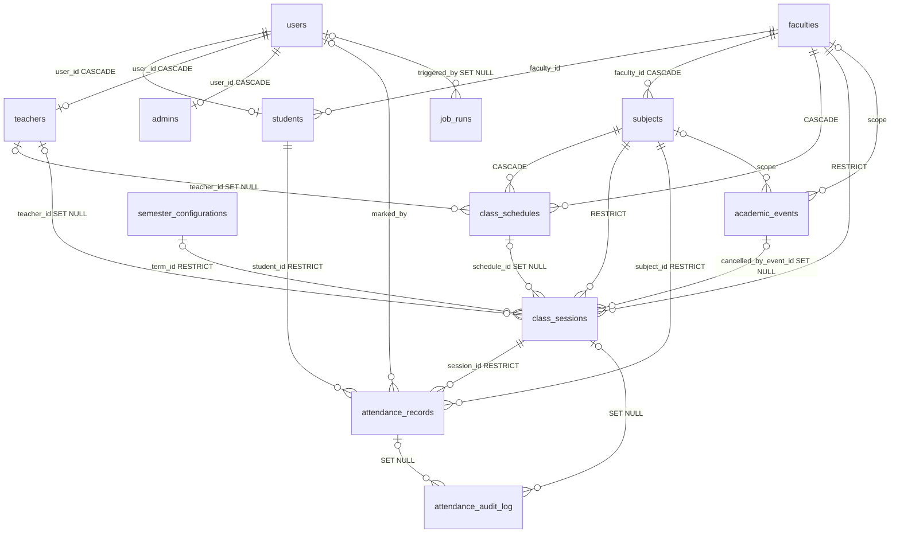

# Database reference

Generated on 2026-10-18 from the live schema (read-only queries against `information_schema`, `pg_constraint`, `pg_enum` and `pg_indexes`) and the models in `backend/app/models/`. Alembic head: `o20261018_class_sessions`. Attendance behaviour is specified in [domain-rules.md](domain-rules.md); this file covers storage only.

## Rules to read first

- **Attendance rows are never deleted.** Every FK into `attendance_records` is `ON DELETE RESTRICT`. To remove a student or teacher, set `users.is_active = false`.
- **Cancellation lives on `class_sessions`**, not on student rows. Never write a per-student `cancelled` status.
- **Only two services write attendance:** `services/attendance_recording.py` (teacher, admin, face check-in) and `services/auto_absent_service.py` (system_auto). Every status change also writes an `attendance_audit_log` row.
- **The current term comes from date ranges** in `semester_configurations`. Ignore `is_current`. `academic_year` columns are labels, never compare them with the calendar year.
- **`day_of_week` stores enum NAMES** (`'SUNDAY'`), not the Python values (`'sunday'`).
- **Use the app clock for business dates.** Never use `CURRENT_DATE` or `now()::date` in SQL; pass `app_today()` from `app/core/clock.py`.
- **Never run `alembic revision --autogenerate` blindly** (see §6).

## 1. Overview

- **Server:** PostgreSQL 17.5, local DB `attendancedb`. The URL is in `backend/.env` (`DATABASE_URL` for asyncpg, `DATABASE_URL_SYNC` for psycopg2/Alembic). The data is dummy, so resetting it is fine.
- **Timezone:** the DB `timezone` is `Asia/Katmandu`. The app setting `APP_TIMEZONE` defaults to `Asia/Kathmandu`. They are aliases for the same zone (UTC+05:45). The new tables use `timestamptz`; many legacy columns are naive `timestamp`.
- **ORM:** SQLAlchemy 2 async with declarative `Base` from `app/core/database.py`. `get_db` is async; a few legacy routes use the sync `get_sync_db`.

| Model file | Contents |
|---|---|
| `models/__init__.py` | `User`, `Faculty`, `Student`, `Admin`, `Teacher`, `Subject`, `AttendanceRecord`, `Mark`, `Notification`, `AIInsight`, `PasswordResetToken`; enums `UserRole`, `AttendanceStatus`, `AttendanceMethod`, `InsightPriority`. It also re-exports the models below. |
| `models/attendance_sessions.py` | `ClassSession`, `AttendanceAuditLog`, `JobRun`; StrEnums `SessionStatus`, `SessionKind`, `AttendanceSource`, `AuditAction`, `ExclusionReason`, `JobRunStatus`; `REAL_ATTENDANCE_SOURCES` |
| `models/calendar.py` | `AcademicEvent`, `EventSession`, `SessionAttendance`, `EventAttendance`, `CalendarSetting`, `AcademicYear`, `SemesterConfiguration`, `AcademicCalendarConfig`, `ClassScheduleTemplate`; `EventType`, `HolidayType`, `EventAttendanceStatus` |
| `models/schedule.py` | `ClassSchedule`, `DayOfWeek` |
| `models/notifications.py` | `EnhancedNotification`, `NotificationReadReceipt`; `NotificationScope`, `NotificationPriority`, `NotificationType` |
| `models/system_settings.py` | `SystemSetting`, `AttendanceThreshold` |

### Core domain (ER summary)



- **users** hold the login. Each user has one profile row by `role`: `students`, `teachers` (role `faculty`) or `admins`.
- **faculties** are departments. A student's cohort is `(students.faculty_id, students.semester)`.
- **subjects** are courses. `faculty_id` is nullable: 120 of the 480 rows are NULL, orphaned by old faculty deletes.
- **class_schedules** is the weekly timetable. Each row is one cohort (`faculty_id` + `semester`), one subject, one weekday and a `start_time`/`end_time`.
  - `teacher_id` is NULL on 2130 of the 2160 rows, so in practice admins take attendance for most classes.
  - `academic_year` is only a label (every row says 2025).
- **semester_configurations** are university-wide terms and the source of truth for the current term. The current term is the active row whose `[start_date, end_date]` contains today.
- **academic_events** are calendar entries: HOLIDAY, EXAM, SPECIAL_EVENT, CANCELLED_CLASS, and CLASS (an optional marker).
  - Each event covers a date range and can be scoped to a faculty and/or a subject.
  - `is_active` is the soft-delete flag.
- **class_sessions** hold one row per class occurrence on a date.
  - `status` is `scheduled`, `held` or `cancelled`; `kind` is `regular` or `makeup`.
  - The schedule fields are copied in as a snapshot when the session is created.
  - Sessions are materialized from schedules on or after `tracking_start_date`; the legacy ones came from the migration backfill.
- **attendance_records** hold one row per (student, session). Each row records `status`, `source` (provenance) and metrics-exclusion flags.
- **attendance_audit_log** is an append-only change history. **job_runs** logs background job runs.
- **system_settings** is a key/JSON store for policy. **attendance_thresholds** stores the percentage bands.

### Live data snapshot (2026-10-18)

| Table | Rows | Notes |
|---|---|---|
| users | 118 | 9 admin, 2 faculty, 107 student. 41 student users have no `students` row. |
| students / teachers / admins | 66 / 2 / 8 | `enrolled_on` and `cohort_since` are NULL everywhere. |
| faculties / subjects | 9 / 480 | |
| class_schedules | 2160 | All active. Sunday to Friday, 360 each. |
| semester_configurations | 4 | Active: Spring 2025, Fall 2025, Spring 2026. Id 4 is inactive. **No term covers today, so the app is `between_terms`.** Fall 2025 still has `is_current = true`. |
| academic_events | 141 | 140 CLASS markers, 1 CANCELLED_CLASS. |
| class_sessions | 1555 | 149 held, 1405 scheduled, 1 cancelled. Dates run 2025-08-01 to 2025-12-17. 31 finalized. 60 have no term. |
| attendance_records | 3399 | absent 3246, present 150, cancelled 3. 269 countable. 0 with NULL `session_id`. |
| attendance_audit_log / job_runs | 1 / 1 | One `legacy_backfill` audit row; one `auto_absent` run. |

## 2. Table reference (live schema)

Notation: `NN` = NOT NULL. FKs are shown as `-> table (ON DELETE action)`; *no action* is PostgreSQL's default and blocks the delete.

### attendance_records

| Column | Type | Null | Default / meaning |
|---|---|---|---|
| id | serial | NN | PK |
| student_id | int | NN | -> students (RESTRICT) `attendance_records_student_id_fkey` |
| session_id | int | NULL | -> class_sessions (RESTRICT) `fk_attendance_session`. NULL only for unmappable legacy rows (0 today); new writes always set it. |
| subject_id | int | NN | -> subjects (RESTRICT) `fk_attendance_subject`. Kept equal to `session.subject_id`. |
| date | date | NN | Kept equal to `session.session_date` |
| status | `attendance_status` | NULL | Default `'present'` |
| source | varchar(16) | NN | Default `'legacy'`; CHECK `ck_attendance_source`: teacher, admin, student_face, system_auto, legacy |
| excluded_from_metrics | bool | NN | Default false |
| exclusion_reason | varchar(64) | NULL | An `ExclusionReason` value, or an admin's text (default `'admin'`) |
| method | `attendance_method` | NULL | Default `'manual'`. Kept consistent with `source` (face / manual / other). |
| marked_by | int | NULL | -> users (*no action*) `fk_attendance_marked_by_user`. NULL for system_auto. |
| time_in, time_out | timestamptz | NULL | Check-in time |
| confidence_score | numeric(5,2) | NULL | Face-match confidence |
| location | varchar(100) | NULL | `'AUTO_ABSENT_SYSTEM'` only on system_auto rows (legacy readers rely on it) |
| period | int | NULL | Legacy, always NULL |
| time_slot | varchar(50) | NULL | `'HH:MM-HH:MM'` |
| notes | text | NULL | |
| created_at, updated_at | timestamptz | NULL | `CURRENT_TIMESTAMP`; `updated_at` is set by trigger |

- **Unique:** `uq_attendance_student_session (student_id, session_id)`, plus the partial unique index `uq_attendance_legacy_day (student_id, subject_id, date) WHERE session_id IS NULL`. Two sessions of one subject on the same day are allowed.
- **Indexes:** `idx_attendance_session_id`, `idx_attendance_date`, `idx_attendance_student_date (student_id, date)`, `idx_attendance_date_subject_period`, `idx_attendance_status`, `idx_attendance_method`, and partial `idx_attendance_location WHERE location = 'AUTO_ABSENT_SYSTEM'`.
- **Trigger:** `update_attendance_records_updated_at`.

### class_sessions

| Column | Type | Null | Default / meaning |
|---|---|---|---|
| id | serial | NN | PK |
| schedule_id | int | NULL | -> class_schedules (SET NULL). NULL for make-ups or after the schedule row is deleted. |
| kind | varchar(16) | NN | `'regular'` \| `'makeup'` (CHECK `ck_class_session_kind`) |
| subject_id | int | NN | -> subjects (RESTRICT). Snapshot. |
| faculty_id, semester | int | NN | -> faculties (RESTRICT). Cohort snapshot. |
| term_id | int | NULL | -> semester_configurations (RESTRICT). NULL if no active term contains the date. |
| session_date | date | NN | |
| start_time, end_time | time | NN | Local wall-clock times. CHECK `ck_class_session_time_order (end_time > start_time)` |
| teacher_id | int | NULL | -> teachers (SET NULL). Snapshot. |
| status | varchar(16) | NN | `'scheduled'` (default) \| `'held'` \| `'cancelled'` (CHECK `ck_class_session_status`) |
| attendance_taken_at | timestamptz | NULL | Time of the first real present/late/absent write |
| submitted_at / submitted_by | timestamptz / int | NULL | Register submission. `submitted_by` -> users (RESTRICT) |
| finalized_at | timestamptz | NULL | Set by the auto-absent finalizer, only on held sessions |
| cancelled_at / cancelled_by / cancellation_reason | timestamptz / int / text | NULL | `cancelled_by` -> users (RESTRICT) |
| cancelled_by_event_id | int | NULL | -> academic_events (SET NULL). The calendar event that cancelled the session. |
| review_required / review_reason | bool NN default false / text | | Set when an event covers a session that already has real records |
| created_at, updated_at | timestamptz | NN | `now()`; trigger `update_class_sessions_updated_at` |

- **Unique:** `uq_class_session_slot (subject_id, faculty_id, semester, session_date, start_time)`, plus the partial unique index `uq_class_session_schedule_date (schedule_id, session_date) WHERE schedule_id IS NOT NULL AND kind = 'regular'`. Materialization uses `INSERT ... ON CONFLICT DO NOTHING` against both.
- **Indexes:** `ix_class_sessions_session_date`, `ix_class_sessions_cohort_date (faculty_id, semester, session_date)`, `ix_class_sessions_status`, `ix_class_sessions_teacher_date (teacher_id, session_date)`, partial `ix_class_sessions_held_unfinalized WHERE status = 'held' AND finalized_at IS NULL`, and partial `ix_class_sessions_cancelled_by_event WHERE cancelled_by_event_id IS NOT NULL`.

### class_schedules

| Column | Type | Null | Notes |
|---|---|---|---|
| id | serial | NN | PK |
| subject_id | int | NN | -> subjects (CASCADE) `fk_class_schedules_subject` |
| faculty_id | int | NN | -> faculties (CASCADE) `fk_class_schedules_faculty` |
| teacher_id | int | NULL | -> teachers (SET NULL) |
| day_of_week | `day_of_week` | NN | `'SUNDAY'`..`'SATURDAY'` |
| start_time, end_time | time | NN | CHECK `ck_class_schedule_time_order (end_time > start_time)` |
| semester | int | NN | Cohort semester, 1-8 |
| academic_year | int | NN | Label only |
| classroom, instructor_name, notes | varchar | NULL | |
| is_active | bool | NULL | NULL is treated as active (`isnot(False)`) |

- **Unique:**
  - `unique_faculty_time_slot (faculty_id, day_of_week, semester, academic_year, start_time)`
  - `unique_classroom_time_slot (classroom, day_of_week, start_time, academic_year)`. A NULL classroom never conflicts.
- **Index:** `idx_class_schedules_teacher_id`.
- **Overlap checks:** cohort, classroom and teacher overlaps are enforced in the routes, not by the DB.

### semester_configurations (terms)

| Column | Type | Null | Notes |
|---|---|---|---|
| id | serial | NN | PK |
| semester_name | varchar(100) | NN | e.g. "Fall 2025" |
| semester_number | int | NN | Reference only; CHECK `valid_semester_number` (1-8) |
| academic_year | int | NN | Label |
| start_date, end_date | date | NN | CHECK `valid_date_range (end_date > start_date)` |
| exam_week_start, exam_week_end | date | NULL | Exam window; regular classes are suspended in it |
| total_weeks | int | NULL | |
| is_current | bool | NULL | **Not authoritative**; API responses compute it from dates |
| is_active | bool | NULL | Soft delete; NULL is treated as active |
| created_by | int | NULL | -> users (*no action*) |
| created_at, updated_at | timestamp | NULL | |

The DB has no overlap constraint. `services/term_service.py` rejects overlapping active terms under `pg_advisory_xact_lock(815200002)`.

### academic_events

- **Columns:** `id`, `title` (varchar(255) NN), `description`, `event_type` (`eventtype` NN), `start_date` (date NN), `end_date` (NULL means one day), `start_time`/`end_time` (NULL means all day), `is_all_day`, `holiday_type` (`holidaytype`), `class_room`, `color_code` (varchar(7) NN), `is_recurring`, `recurrence_pattern` (json), `notification_settings` (json), `created_at`/`updated_at` (timestamp).
- **Scope:** `subject_id` -> subjects and `faculty_id` -> faculties, both *no action*. NULL means every subject / faculty.
- **Flags:** `is_active` is the soft delete (NULL is treated as active). `attendance_required = true` lets classes run during an EXAM.
- **Other keys:** `created_by` -> users (NN, *no action*). The table has no CHECK constraints.
- **Coverage:** an event covers date `d` when `start_date <= d <= coalesce(end_date, start_date)`, with the scope match and `is_active IS NOT FALSE`.

### People and catalog

- **users:** `email` (varchar(255) NN UNIQUE), `full_name` NN, `hashed_password` NN, `role` (`user_role` NN, default `'student'`), `is_active` (default true), timestamps (timestamptz).
  - Indexes `idx_users_email`, `idx_users_role`.
  - Triggers `update_users_updated_at` and `trigger_sync_student_name` (AFTER UPDATE OF full_name: copies the name into `students.name`).
- **students:** `user_id` -> users (CASCADE, UNIQUE, NN), `student_id` (varchar(50) NN UNIQUE; the roll number), `faculty_id` -> faculties (*no action*, NULL), `semester`/`year`/`batch` (int NN), `enrolled_on`/`cohort_since` (date NULL), `face_encoding` (json; the composite face template, never returned by the API), `face_enrollment_status` (varchar(16) NN default `'none'`, CHECK `ck_students_face_enrollment_status`: none, enrolled, reset, deleted), `face_registered_at`/`face_consent_at` (timestamptz), `face_model` (varchar(64)), `profile_image_url`, `phone_number`, `emergency_contact`, timestamps (timestamptz).
  - `faculty` (varchar(100) NN) is the legacy faculty name and is still required on insert. `name` (varchar(255)) is filled by the trigger.
  - Indexes `idx_students_student_id`, `idx_students_user_id`, the duplicate `students_user_id_idx`, `idx_students_class_year (faculty, year)` and partial `students_face_encoding_not_null_idx`.
- **teachers:** `user_id` -> users (CASCADE, UNIQUE), `teacher_id` (varchar NN UNIQUE; staff code), `name` NN, `faculty_id` -> faculties (SET NULL), `department`, `phone_number`, `office_location`, timestamps.
- **admins:** `user_id` -> users (CASCADE, UNIQUE), `admin_id` (varchar NN, unique index `ix_admins_admin_id`), `name` NN, `department`, `permissions` (text[]), timestamps (timestamptz).
- **faculties:** `name` (NN UNIQUE), `code` (varchar(50) UNIQUE NULL; prefix for student IDs), `description`, `created_at`.
- **subjects:** `name` NN, `code` (NN UNIQUE), `description`, `credits`, `class_schedule` (json, legacy), `faculty_id` -> faculties (**CASCADE**, `fk_subjects_faculty`), timestamps (timestamptz).

### attendance_audit_log and job_runs

- **attendance_audit_log:**
  - `attendance_record_id` -> attendance_records (SET NULL), `session_id` -> class_sessions (SET NULL), `student_id` (plain int, no FK, so the history survives).
  - `action` (varchar(32) NN; `AuditAction`, no CHECK), `old_status`/`new_status`/`old_source`/`new_source` (varchar(16)), `reason` (text), `context` (jsonb).
  - `changed_by` -> users (RESTRICT; NULL means the system), `changed_at` (timestamptz NN default `now()`). Indexes on record, session and changed_at.
- **job_runs:**
  - `job_name` (varchar(64) NN), `started_at` (NN default `now()`), `finished_at`, `params`/`result` (jsonb), `error`.
  - `status` defaults to `'running'`; CHECK `ck_job_run_status`: running, success, failed, skipped.
  - `triggered_by` -> users (SET NULL; NULL means the scheduler). Index `ix_job_runs_job_started (job_name, started_at)`.
  - A row is written only when the run acquires the lock or fails.

### Face verification tables

Created by `p20261018_face_verification`; the rules are in [face-verification.md](face-verification.md). All FKs to `students` are **CASCADE** (biometric data belongs to the student; attendance stays RESTRICT).

- **face_templates:** one embedding per valid enrolment frame. `model` (varchar(64) NN, e.g. `insightface/buffalo_l`), `pose` (CHECK front/left/right), `embedding` (jsonb NN, 512 floats), `quality` (jsonb), `created_at`. Index `ix_face_templates_student`.
- **face_challenges:** single-use liveness challenges. `id` (varchar(32) PK, uuid4 hex), `purpose` (CHECK checkin/enrolment), `action` (CHECK turn_left/turn_right/front_left_right), `session_id` -> class_sessions (SET NULL), `created_at`, `expires_at` NN, `used_at`.
- **face_verification_attempts:** one row per check-in, verify or enrolment request. `purpose` (CHECK checkin/verify/enrolment), `outcome` (varchar(32) NN: `success` or a rejection code), `counts_as_failure` (lock-out), `similarity`/`liveness_score` (numeric(6,4)), `details` (jsonb), `ip_address`, `session_id` -> class_sessions (SET NULL), `challenge_id`. Indexes `(student_id, created_at)` and `(session_id)`.
- **face_enrollment_events:** audit trail. `action` (CHECK enrolled/reset/deleted/duplicate_blocked/spoof_blocked), `actor_user_id` -> users (SET NULL), `reason`, `details` (jsonb), `created_at`.

### system_settings and attendance_thresholds

`system_settings` columns: `key` (NN UNIQUE), `value` (**jsonb** NN), `category` NN, `description`, `data_type` NN, `is_active`, `updated_by` (plain int, no FK), timestamps. The policy loader is `services/attendance_policy.py` (`get_attendance_policy`). It falls back to defaults when a value is missing or invalid.

| Key | Value (live) | Used for |
|---|---|---|
| `attendance_minimum` | `{"percentage": 75.0}` | Eligibility threshold; also the at-risk/critical band boundary |
| `academic_calendar_type` | `{"type": "nepal", ...}` | Weekly off days. `nepal` means Saturday; `international` means Saturday and Sunday. An optional `weekly_off_days` list overrides both. |
| `attendance_policy` | `checkin_opens_minutes_before` 10, `checkin_closes_after_minutes` 20, `late_after_minutes` 10, `finalize_grace_minutes` 15, `teacher_edit_window_days` 7, `late_counts_as_attended` true, `auto_absent_lookback_days` 7, `exam_days_suspend_classes` true, **`tracking_start_date` "2026-10-18"** | Session policy. `tracking_start_date` is locked: `PUT` on settings rejects any change to it (`routes/system_settings.py`). |
| `face_verification` | Defaults in [face-verification.md §4](face-verification.md) | Face verification, liveness and presence-code policy (`services/face_policy.py`). `PUT` merges partial values and validates every key. |
| `attendance_calculation_method` | `{"method": "accurate"}` | Legacy; nothing in the redesign reads it |
| `enable_custom_thresholds` | `{"enabled": true}` | UI flag |

`attendance_thresholds` columns: `name`, `min_percentage` (float NN), `max_percentage`, `color`/`badge_style`/`label` (NN), `description`, `"order"` (int NN; a reserved word, so quote it), `is_active`. There are 4 rows: excellent 90, good 85, warning 75, critical 0. The loader builds half-open bands `[min, next_min)` and ignores `max_percentage`. It also forces the at-risk/critical boundary to `attendance_minimum`.

### Notifications

- **enhanced_notifications** (the live feature): `type`, `priority`, `scope` are plain varchar (the models use `native_enum=False`, with no CHECK). FKs `sender_id` -> users, `target_faculty_id` -> faculties, `target_user_id` -> users. Also `payload` (jsonb), `expires_at`, `is_active`.
- **notification_read_receipts:** `notification_id` -> enhanced_notifications (CASCADE) and `user_id` -> users. It has two identical unique constraints on `(notification_id, user_id)`.
- **notifications:** the legacy per-user table (model `Notification`, 0 rows).

### Dormant and legacy objects

| Object | State |
|---|---|
| `event_attendance`, `session_attendance`, `event_sessions` | Dormant, 0 rows. `status` uses `attendancestatus`. No UNIQUE(event_id, student_id). `event_sessions.parent_event_id` CASCADE. |
| `academic_calendar_config` | **Deprecated** month/day term override, 0 rows. Its write endpoints return 410; terms are managed in `semester_configurations`. Partial unique index `idx_single_active_override`. |
| `academic_years` (1 row), `class_schedule_templates`, `calendar_settings`, `marks`, `ai_insights` | Modelled; unused by the attendance domain |
| `classes`, `face_recognition_logs` | No model, 0 rows |
| `students_backup_20251101_005948`, `_010133`, `_010240` | 102 rows each. No PK, no model. Excluded from `baseline.sql`. |
| View `student_attendance_summary` | Legacy. It counts every record, including excluded rows and rows in cancelled or unheld sessions, so **never use it for metrics.** |
| `password_reset_tokens` | Live feature. Has duplicate FKs to users (`fk_user_id` and `password_reset_tokens_user_id_fkey`, both CASCADE). |
| Functions | `update_updated_at_column()` (BEFORE UPDATE triggers on admins, ai_insights, attendance_records, class_sessions, classes, students, users) and `sync_student_name()` |

## 3. Enums

| DB type | Labels (sort order) | Column(s) | Python enum | Stored as |
|---|---|---|---|---|
| `attendance_status` | present, absent, late, cancelled, excused | attendance_records.status | `AttendanceStatus` (`models/__init__.py`) | values (`PGEnum`, `values_callable`, `create_type=False`) |
| `attendance_method` | manual, face, other | attendance_records.method | `AttendanceMethod` | values |
| `user_role` | student, admin, faculty | users.role | `UserRole` | The model declares `native_enum=False`; the DB has a native enum |
| `day_of_week` | SUNDAY ... SATURDAY | class_schedules.day_of_week | `DayOfWeek` (`models/schedule.py`; values are lowercase) | **NAMES** |
| `eventtype` | CLASS, HOLIDAY, EXAM, SPECIAL_EVENT, CANCELLED_CLASS | academic_events.event_type | `EventType` (values are lowercase) | NAMES |
| `holidaytype` | FULL_DAY, HALF_DAY | academic_events.holiday_type | `HolidayType` | NAMES |
| `attendancestatus` | PRESENT, ABSENT, PENDING, STARTS_SOON | event_attendance.status, session_attendance.status | `EventAttendanceStatus` (`models/calendar.py`) | NAMES. The Python enum also has `CANCELLED`, which the DB lacks, so writing it fails. |
| `attendancestatuscalendar` | present, absent, pending, starts_soon | none | none | Unused |
| `insight_priority` | low, medium, high | ai_insights.priority | `InsightPriority` | The model declares `native_enum=False` |

- **Two attendance enums:** `from app.models import AttendanceStatus` is *class* attendance. The calendar enum was renamed `EventAttendanceStatus` so the names don't collide; don't reintroduce the old name.
- **Comparing roles:** `UserRole` is a plain `enum.Enum`, so `user.role == "admin"` is always False. Compare with `UserRole.admin`.
- **Weekday mapping:** map a date to `DayOfWeek` with `instructional_calendar.weekday_to_day_of_week`. In raw SQL, compare `day_of_week::text` with `'SUNDAY'` and the like.
- **VARCHAR + CHECK "enums"** (adding a value needs only a CHECK change):
  - `class_sessions.status` (`SessionStatus`)
  - `class_sessions.kind` (`SessionKind`)
  - `attendance_records.source` (`AttendanceSource`; `REAL_ATTENDANCE_SOURCES` = teacher, admin, student_face)
  - `job_runs.status` (`JobRunStatus`)
- **No CHECK at all:** `attendance_audit_log.action` (`AuditAction`: create, update, session_cancelled, session_uncancelled, session_submitted, finalize, legacy_backfill, metrics_exclusion, review_cleared) and `exclusion_reason` (`ExclusionReason`: legacy_unheld_session, outside_term, recorded_before_class, before_enrollment).

## 4. Data invariants and integrity rules

1. **Attendance is never cascade-deleted.**
   - `student_id`, `subject_id` and `session_id` are all RESTRICT.
   - `users -> students` is still CASCADE, so a user whose student has attendance cannot be deleted; the DB refuses.
   - `marked_by` is *no action*, so a user who marked attendance cannot be deleted either.
   - ORM relationships use `passive_deletes="all"` so the ORM never NULLs these FKs (`User.student_profile`, `User.attendance_marked`, `Student.attendance_records`, `Faculty.students`, the `academic_events` backrefs).
2. **Deleting people means deactivating them** (`users.is_active = false`).
   - Student delete deactivates by default; a permanent delete returns 409 when attendance exists.
   - Teacher delete deactivates when the user marked attendance or is referenced elsewhere, and hard-deletes otherwise.
   - Admin delete removes the admin profile and deactivates the login.
3. **Deleting catalog rows.**
   - **Faculty:** cascades to `subjects` and `class_schedules`, but is blocked by students (*no action*), sessions and attendance (RESTRICT).
   - **Subject:** cascades to its schedules, and sessions keep the snapshot (`schedule_id` becomes NULL). Blocked by attendance and sessions.
   - **Schedule with sessions:** the API deactivates it instead of deleting it.
   - **Term with sessions:** blocked by `term_id` RESTRICT.
   - **Events:** soft-delete them (`is_active = false`). Never NULL an event's `subject_id`/`faculty_id`, because that widens its scope to everything.
4. **One record per (student, session).** New writes always set `session_id`. They also fill the legacy columns:
   - `date = session_date` and `subject_id = session.subject_id`
   - `time_slot` as `'HH:MM-HH:MM'`
   - `method` to match `source`
   - `location = 'AUTO_ABSENT_SYSTEM'` only for system_auto, with `marked_by` NULL
5. **Never write per-student `cancelled` rows.** Cancellation is `class_sessions.status = 'cancelled'` plus `cancelled_at`, `cancelled_by`, `cancellation_reason` and `cancelled_by_event_id`.
   - Records inside a cancelled session are kept and drop out of metrics automatically.
   - The 3 existing `cancelled` rows are legacy (source `legacy`).
6. **`excused`** is admin-only. It never changes the session status and is never countable.
7. **Session lifecycle.**
   - `scheduled -> held` on the first teacher/admin/student_face write of present, late or absent, or on a register submission. This sets `attendance_taken_at` (and `submitted_*` for a submission).
   - Un-cancelling restores `held` if the session has real records, otherwise `scheduled`.
   - `finalized_at` is set only on held sessions, after the finalizer inserts system_auto absences for roster students who have no record.
   - Sessions that were never held are never auto-absented; they show up as *unrecorded*.
8. **Countable record** (used by metrics in `services/attendance_metrics.py`): the session is `held`, the record status is present/late/absent, `excluded_from_metrics = false` and `session_id` is not NULL.
9. **Legacy fabricated auto-absences are kept, not deleted.** They are flagged `excluded_from_metrics = true` with `exclusion_reason = 'legacy_unheld_session'` (system_auto rows in sessions that were never held).
   - Other reasons: `recorded_before_class`, `before_enrollment`, and `outside_term` (assigned to 0 rows because it is evaluated after `legacy_unheld_session`).
   - A teacher or admin rewrite of a record excluded as `legacy_unheld_session` or `recorded_before_class` clears the flag. The clearing is audited (`context.cleared_exclusion`).
   - Admins toggle exclusion with `PATCH /api/attendance/records/{id}/metrics-exclusion`, which writes audit action `metrics_exclusion`.
10. **Audit.** Every create, status change, cancel/un-cancel, submit, finalize and exclusion toggle writes an `attendance_audit_log` row. A same-status write is a no-op unless it clears a provenance exclusion. Application code never deletes audit rows.
11. **`tracking_start_date`** (2026-10-18, locked) marks where session-based tracking starts.
    - Sessions are never materialized before it.
    - Older sessions are legacy, kept "as recorded": they are never finalized and never listed as unrecorded. No *new* regular or make-up session can be created before this date (`before_tracking_start`, 404). Existing legacy sessions can still be corrected through the recording service; in practice only by admins, because a teacher's edit window has long passed.
12. **Terms.** The current term is the active (`is_active IS NOT FALSE`) row containing `app_today()`. With none, the app is `between_terms`: no sessions, auto-absent idles and metrics report the most recent past term.
13. **Enrollment start** is `coalesce(enrolled_on, (created_at AT TIME ZONE 'Asia/Kathmandu')::date)`.
    - `cohort_since` is set when an admin changes a student's `faculty_id` or `semester`.
    - A session's roster is the active users of that cohort with `session_date >= max(enrollment_start, coalesce(cohort_since, enrollment_start))`.
14. **Concurrency.**
    - The auto-absent run holds `pg_try_advisory_lock(815200001)` on a dedicated connection.
    - Recording, cancelling and finalizing lock the session row first (`SELECT ... FOR UPDATE`).
    - Term writes take `pg_advisory_xact_lock(815200002)`.
15. **Snapshots.** Existing sessions never read `class_schedules.is_active` or the schedule's current times. A same-day schedule time edit applies from the next materialization.

## 5. Migrations

### Running them

```bash
cd backend && venv/Scripts/python.exe -m alembic upgrade head      # also: current, heads, history
```

`alembic/env.py` overrides `sqlalchemy.url` with `settings.database_url_sync`, read from `DATABASE_URL_SYNC` in `backend/.env`. The URL hard-coded in `alembic.ini` is therefore ignored when you run from `backend/`.

The local DB holds dummy data, so it needs no backup. Take a `pg_dump -Fc` before migrating any real database, because downgrade loses history (see below).

### The chain

- There is a single head, `p20261018_face_verification` (face verification tables), which revises `o20261018_class_sessions` (the attendance redesign), which revises `n20251103_payload_receipts`.
- There are **4 root revisions**: `001`, `008_rename_class_name_to_faculty`, `20250724_add_faculty_table` and `add_name_to_admins`. They are joined by merge revisions.
- The roots assume tables already exist (for example, `001` alters `attendance_records`). As a result, **`alembic upgrade head` on an empty database fails**; the base schema exists only in real databases.
- `009_conf_score_fix` and `009_update_confidence_score_precision` duplicate each other.

### What `o20261018_class_sessions` did

File: `alembic/versions/20261018_class_sessions_attendance_redesign.py`.

1. **DDL:**
   - Added the enum label `attendance_status.'excused'` (in an `autocommit_block`).
   - Created `class_sessions` (with its trigger), `attendance_audit_log` and `job_runs`.
   - Added `attendance_records.session_id`, `source`, `excluded_from_metrics` and `exclusion_reason`, plus `idx_attendance_session_id`.
   - Added `students.enrolled_on` and `cohort_since`.
   - Added `class_schedules` CHECK `end_time > start_time`.
   - Changed the attendance student FK from CASCADE to RESTRICT, and the subject FK from *no action* to RESTRICT.
2. **Source backfill**, with rules evaluated in order:
   1. Untouched auto-absences become `system_auto`.
   2. `marked_by` admin becomes `admin`.
   3. `marked_by` faculty becomes `teacher`.
   4. Face check-ins by a student become `student_face`.
   5. Anything else stays `legacy`.

   Result: system_auto 3121, admin 259, student_face 12, teacher 3, legacy 4.
3. **Sessions:** each of the 1555 (subject, date) groups mapped to exactly one schedule row, with none ambiguous or unmapped.
   - That produced 149 held, 1405 scheduled and 1 cancelled session (by CANCELLED_CLASS event 961, 2025-11-03).
   - 31 sessions were finalized and 0 flagged `review_required`.
   - 60 sessions have no term; all are dated 2025-12-17, after Fall 2025 ended.
   - Every record got a `session_id`.
4. **Exclusions:** `legacy_unheld_session` 3070, `before_enrollment` 35, `recorded_before_class` 22. That leaves **269 countable** records.
5. **Uniqueness swap:** the migration created `uq_attendance_student_session` and `uq_attendance_legacy_day`, and dropped `unique_attendance_student_subject_date`.
6. **Settings:** it inserted the `attendance_policy` setting with `tracking_start_date` set to the migration date, using `ON CONFLICT DO NOTHING`.
7. **Audit:** it wrote one `legacy_backfill` audit row with every count in `context`.

No attendance row was deleted and no status changed. User triggers were disabled during the backfill, so `updated_at` was preserved.

### Downgrade caveats

`downgrade -1` restores the old unique constraint and FK actions and drops the new tables and columns. It **fails loudly** in two cases:
- any `excused` record exists
- any (student, subject, date) has more than one record

It also loses all `attendance_audit_log` and `job_runs` history.

PostgreSQL cannot drop enum values, so **the `'excused'` label stays**. The `attendance_policy` setting also stays.

### Tests and empty databases

The pytest harness never builds the schema from models or from Alembic alone (details in [testing.md](testing.md)):
1. Create `attendancedb_test`.
2. Load `backend/tests/schema/baseline.sql`, a `pg_dump --schema-only --no-owner --no-privileges -T 'students_backup_*'` of the **pre-redesign** DB.
3. Load `seed_reference.sql` (system_settings and thresholds).
4. `alembic stamp n20251103_payload_receipts`, then `alembic upgrade head`.

This way every run exercises the latest migration's DDL. `tests/schema/regenerate_baseline.py` re-dumps from live. Live is now at the new head, though, so regenerating would require moving `BASELINE_REVISION` in `tests/support/testenv.py`, and the redesign DDL would then no longer be tested.

### Writing a new migration

- Hand-write it with `op.execute` or `sa.text`, chained from the current head.
- Name every constraint and index explicitly.
- Put `ALTER TYPE ... ADD VALUE` inside `op.get_context().autocommit_block()`.
- Make backfills preserve statuses (assert on them, as `o20261018` does).
- Update the matching model in the same change, so the reconciled tables stay drift-free.
- Run the suite; the harness applies your revision.

**Never rely on `alembic revision --autogenerate`.** Today `compare_metadata` reports 94 differences, all outside the reconciled tables. An autogenerated revision would:
- drop `classes`, `face_recognition_logs` and the backup tables
- drop and re-add FKs without their CASCADE
- rename indexes
- change `users.role` to VARCHAR and `system_settings.value` to JSON

If you use it to draft, delete every operation you didn't intend.

## 6. Model ↔ DB drift

Checked on 2026-10-18 with `alembic.autogenerate.compare_metadata(compare_type=True)` against live: 94 differences, down from 126 in the earlier audit.

**Reconciled exactly (0 differences):**
- `attendance_records`, `class_sessions`, `attendance_audit_log`, `job_runs`
- `class_schedules`, `semester_configurations`, `academic_events`, `faculties`
- `students` (only the duplicate index `students_user_id_idx` is intentionally left out of the model)
- also `event_attendance`, `session_attendance`, `calendar_settings`, `academic_years`, `class_schedule_templates`

Autogenerate compares neither enum labels nor server defaults. Two mismatches are invisible to it:
- `EventAttendanceStatus.CANCELLED` does not exist in the DB.
- The calendar models use Python-side `datetime.utcnow` defaults.

**Still drifting:**

| Table | Model vs DB |
|---|---|
| users | `role` is VARCHAR in the model and native `user_role` in the DB. Timestamps are naive in the model and timestamptz in the DB. Index names differ. |
| teachers, admins | The DB has FKs to users with ON DELETE CASCADE (teachers also have faculty SET NULL); the models don't declare them. Index names differ. `admins.permissions` is text[] in the DB and String[] in the model. |
| subjects | `fk_subjects_faculty` CASCADE isn't modelled. Naive vs timestamptz timestamps. The unique on `code` is a constraint in the DB and an index in the model. |
| system_settings | `value` is JSON in the model and **jsonb** in the DB. Index names differ. |
| ai_insights (16), notification_read_receipts, enhanced_notifications, password_reset_tokens, marks, notifications, attendance_thresholds, academic_calendar_config, event_sessions | Types (jsonb vs json, timestamptz), FK CASCADE not modelled, duplicate or renamed indexes |
| DB-only objects | `classes`, `face_recognition_logs`, `students_backup_*`, view `student_attendance_summary`, both trigger functions, enum `attendancestatuscalendar` |

The never-imported duplicate modules `models/faculties.py` and `models/subjects.py` were deleted in the redesign. **Don't use `Base.metadata.create_all`** to build a schema: it produces VARCHAR enums, missing CASCADE/RESTRICT actions and no triggers.
